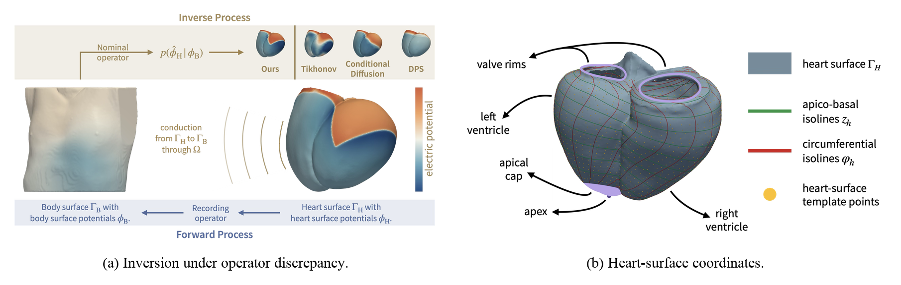

# Electrocardiographic Imaging via Posterior Sampling under Operator Discrepancy

[](https://doi.org/10.5281/zenodo.23449575)

This repository accompanies [*Electrocardiographic Imaging via Posterior Sampling under Operator
Discrepancy*](https://projects.cairo.thws.de/asml/papers/ecgi/) by Ricarda Buttmann and Andreas M.
Lehrmann. It contains the paper's reconstruction and evaluation code, data loaders, three runnable
examples, and the small likelihood artifacts used by OpDis-PS. Datasets are distributed through
Zenodo, and the pretrained checkpoints are available with the GitHub release.

**Background in one paragraph.** Electrocardiographic imaging (ECGI) reconstructs the electrical
potentials on the heart surface (HSP) from body-surface potentials (BSP) recorded by torso
electrodes. A linear forward operator `A` maps HSP to BSP. In practice, the operator used for
reconstruction differs from the one that generated the recording, for example because the lung
conductivity or the subcutaneous fat layer is misspecified. This *operator discrepancy* is what
OpDis-PS models. All released reconstructions live on a fixed 30 x 60 grid in epicardial chart
coordinates, so every heart has 1,800 HSP values per time step; the examples have 176 electrodes
and 91 time steps at 5 ms.



*ECGI task and heart-surface representation.*

The numerical models, samplers, likelihood functions, and metrics under `src/ecgi/` are the
implementations used for the paper experiments. The code under `src/opdis_ps/` provides the
release-specific interfaces for loading the public packages and running the methods.

## Release packages

| Package | Size | Purpose | Distribution |
|---|---|---|---|
| `paper-evaluation-v1` | 1.0 GiB | reproduce the paper evaluation on the fixed 30 x 60 chart | [datasets](https://doi.org/10.5281/zenodo.23449575) |
| `paper-training-v1` | 3.7 GiB | retrain and reselect the learned paper methods | [datasets](https://doi.org/10.5281/zenodo.23449575) |
| `native-ecgi-v1` | up to 161 GiB | native-resolution HSP, heart and torso surfaces, optional lung surfaces, placements, electrodes, and fine operators | [datasets](https://doi.org/10.5281/zenodo.23449575) |
| `paper-pretrained-models-v1` | 0.8 GiB | 15 checkpoints: five replicates each of the prior, Transformer, and Palette | [GitHub release](https://github.com/ricardabuttmann/ecgi-opdis-ps/releases/tag/v1.0.0) |
| [`artifacts/`](artifacts/) | 1.3 MiB | fitted approximation-error models for both discrepancy settings | included in this repository |

The bundled examples and the classical methods need none of these packages. The learned methods
need `paper-pretrained-models-v1`; the cohort benchmark additionally needs `paper-evaluation-v1`.

By default, the commands look for extracted packages under `artifacts/`, but another location can
be passed explicitly. For the component-based native dataset, extract all selected TAR files into
the same destination; see [`docs/native_dataset.md`](docs/native_dataset.md). Checksums are provided
with every download.

## Installation

Use Python 3.12. The release was tested with Python 3.12.13 and the exact top-level versions in
[`requirements-tested.txt`](requirements-tested.txt).

```bash
python3.12 -m venv .venv
source .venv/bin/activate
python -m pip install -r requirements-tested.txt
python -m pip install -e . --no-deps --no-build-isolation
python -m pytest
```

[`docs/environment.md`](docs/environment.md) explains these steps and lists the hardware
requirements.

## Quick start

Run a fast CPU method on the lung-conductivity example:

```bash
python scripts/run_example.py --method tikhonov --case lung-conductivity
```

`--case` also accepts `subcutaneous-fat` and `lbbb-lung-conductivity`, the complete-LBBB case shown
in the paper's qualitative comparison. Each run writes `reconstruction.npz` and `metrics.json` under
`outputs/<case>/<method>/` and updates the combined `outputs/<case>/results.csv` and
`results.html`. The HTML summary opens automatically; pass `--no-open` on a remote machine, cluster,
or CI runner.

The result table reports the paper metrics RE, ATE (ms), LE (mm), sCC, and tCC. Expected Tikhonov
and replicate-0 Transformer values for all three examples are listed in
[`docs/reference_results.csv`](docs/reference_results.csv).

Learned methods additionally read checkpoints from `paper-pretrained-models-v1`. The checkpoint
archive is a separate GitHub Release asset; it is not included in a Git clone or GitHub's generated
source archives. From the repository root, download both model assets, verify the archive, extract
it into `artifacts/`, and validate the extracted package:

```bash
curl -LO https://github.com/ricardabuttmann/ecgi-opdis-ps/releases/download/v1.0.0/paper-pretrained-models-v1.tar
curl -LO https://github.com/ricardabuttmann/ecgi-opdis-ps/releases/download/v1.0.0/paper-pretrained-models-v1.tar.sha256
sha256sum -c paper-pretrained-models-v1.tar.sha256
mkdir -p artifacts
tar -xf paper-pretrained-models-v1.tar -C artifacts/
python scripts/validate_pretrained_models.py artifacts/paper-pretrained-models-v1
```

On macOS without GNU coreutils, use
`shasum -a 256 -c paper-pretrained-models-v1.tar.sha256` for the archive check. The validator reads
the extracted files without modifying them and reports `"status": "ok"` when all 15 checkpoints,
their metadata, and their checksums are valid.

Then select one of the five paper replicates with `--replicate 0` through `--replicate 4`
(default 0):

```bash
python scripts/run_example.py --method transformer --case lung-conductivity \
  --models artifacts/paper-pretrained-models-v1
```

To run every method on one example, use `run_all_methods.py`. It requires `--models` and uses the
frozen 16-draw diffusion settings, so a CUDA GPU is needed to finish in practical time. On a CPU,
run the classical methods and the Transformer individually instead.

```bash
python scripts/run_all_methods.py \
  --case lung-conductivity \
  --models artifacts/paper-pretrained-models-v1
```

From the repository root, the installed console script `opdis-run-example` is equivalent to
`python scripts/run_example.py`.

## Methods and frozen settings

All settings are frozen in [`configs/paper/`](configs/paper/).

| Group | Method | Paper setting | Needs |
|---|---|---|---|
| Variational | `tikhonov` | spatial order 1, GCV | CPU |
| Variational | `st-tikhonov` | spatial order 1, temporal order 2, GCV, rho=1 | CPU |
| Variational | `tv` | alpha=0.01, epsilon=1e-6, tolerance=1e-5, at most 100,000 iterations | CPU, about a minute |
| Amortized | `transformer` | direct temporal Transformer | checkpoint |
| Amortized | `palette` | BSP-conditioned diffusion, cold start, 50 steps, eta=0, 16-draw mean | checkpoint, CUDA recommended |
| Posterior sampling | `dps` | zeta=40, 50 steps, eta=0, 16-draw mean | checkpoint, CUDA recommended |
| Posterior sampling | `ddrm` | measurement-only DDRM, eta=1, eta_b=1, 20 steps, 16-draw mean | checkpoint, CUDA recommended |
| Posterior sampling | `opdis-ps` | conditional-B correction and residual covariance; DDRM sampler settings | checkpoint, artifact, CUDA recommended |
| Ablation | `opdis-ps-marginal` | **OpDis-PS (marginal)** | checkpoint, artifact, CUDA recommended |
| Ablation | `opdis-ps-marginal-isotropic` | **OpDis-PS (marginal, matched isotropic)** | checkpoint, artifact, CUDA recommended |

`CUDA recommended` marks methods whose complete 16-sample evaluation is intended for a
CUDA-capable GPU. CPU execution remains available for compatibility and small tests, but is
generally impractical for full runs. The Transformer selects CUDA, Apple MPS, or CPU automatically;
the diffusion methods use CUDA when available and otherwise fall back to CPU. The OpDis-PS
variants automatically read the matching likelihood artifact from
[`artifacts/`](artifacts/README.md).

## Further documentation

| Task | Document |
|---|---|
| Run single benchmark cases, complete cohorts, and aggregate training replicates | [`docs/benchmark.md`](docs/benchmark.md) |
| Load native-resolution signals, surfaces, torsos, and operators | [`docs/native_dataset.md`](docs/native_dataset.md) |
| Retrain the prior, Transformer, and Palette | [`docs/train_public_models.md`](docs/train_public_models.md) |
| Environment, devices, and GPU memory | [`docs/environment.md`](docs/environment.md) |
| Array schema of the bundled examples | [`examples/README.md`](examples/README.md) |
| Likelihood artifacts and package locations | [`artifacts/README.md`](artifacts/README.md) |
| Upstream heart and torso datasets | [`THIRD_PARTY_DATA.md`](THIRD_PARTY_DATA.md) |

## Repository layout

```text
src/ecgi/          paper implementations: forward operators, models, samplers, metrics, training
src/opdis_ps/      release interfaces: data loaders, method runner, cohort runner, validation
scripts/           command-line entry points used in this README and in docs/
configs/paper/     frozen inference settings, one file per method
configs/training/  frozen training settings for the prior, Transformer, and Palette
examples/          three self-contained 40 dB example cases
artifacts/         OpDis-PS likelihood artifacts; default location for extracted packages
docs/              detailed guides and reference results
tests/             structural and regression tests
```

Verify the binary files bundled in this repository with `sha256sum -c CHECKSUMS.sha256` (on macOS
without GNU coreutils: `shasum -a 256 -c CHECKSUMS.sha256`).

## Reproducibility coverage

This repository covers public data consumption, paper inference, and reproducible evaluation: the
reported methods and metrics, frozen settings with external pretrained-model loading, three
self-contained 40 dB examples, indexed paper-benchmark execution, portable training entry points,
native-resolution data access, and reference results. Raw CT processing, mesh generation, cohort
simulation, FEM assembly, and cluster orchestration remain outside this repository.

## License, citation, and contact

The software in this repository is released under the [MIT License](LICENSE). Separately
distributed data packages and third-party source datasets retain their stated data licenses; see
[`THIRD_PARTY_DATA.md`](THIRD_PARTY_DATA.md). Citation metadata are provided in
[`CITATION.cff`](CITATION.cff) and [`CITATION.bib`](CITATION.bib). For questions about the release,
contact [Ricarda Buttmann](mailto:ricarda.buttmann@thws.de).
